# Beneath the Green Skin

**A solo-developed 2D top-down action-adventure game built with Unity.**

Switch between combat and disguise, explore a kingdom under goblin invasion, and fight alongside your allies to reclaim its lands.

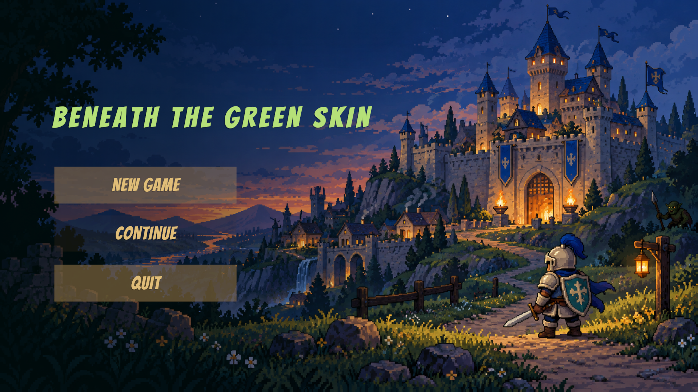

## About the Game

A goblin invasion has shattered the kingdom's peace. Rescued by villagers after being wounded in battle, a knight awakens and sets out once more. He possesses an unusual ability: taking the form of an enemy to conceal his identity among the goblins.

Play as the knight as you explore villages, mines, and enemy strongholds. Meet NPCs, take on quests, and combine melee combat, defense, transformation, and archer support to help the kingdom fight back.

| Overview | Details |
| --- | --- |
| Genre | Single-player · 2D top-down · Action-adventure |
| Development | Solo design and development |
| Engine and language | Unity 2022.3.62f3c1 / C# |
| Core tools | Tilemap, Animator, Physics 2D, Cinemachine, TextMesh Pro |
| In-game language | English |
| Status | In development; this repository showcases the project, with no playable release available yet |

## My Role

I independently designed and developed this project, taking it from gameplay concepts and level construction through implementation and integration. My work includes:

- **Gameplay design and programming:** player movement, normal attacks, hold-to-perform heavy attacks, defense, damage feedback, transformation, and archer support.
- **Enemy and encounter design:** standard, bomb-throwing, and elite enemies, along with the behaviors and encounter flow of the Troll and Shaman bosses.
- **Narrative and level design:** a prologue and three quest stages, NPC dialogue, quest triggers, area progression, and scripted sequences.
- **World building and environmental presentation:** constructing villages, mines, interiors, and enemy strongholds with Tilemaps and art assets, and integrating day/night changes, lighting, rain, water, and puddle effects.
- **UI and game flow:** the main menu, player status HUD, quest journal, dialogue interface, save/continue functionality, death and respawn, and the ending sequence.
- **Testing and iteration:** refining quest progression, combat feedback, world interactions, and interface presentation.

The project uses **Pixel Frog's Tiny Swords asset pack** for characters, buildings, terrain, and some UI elements. Solo development refers to my design, programming, and integration work. Third-party artwork is credited to its original creators below.

## Gameplay and Systems

### Melee Combat, Defense, and Enemy Encounters

Use normal attacks, heavy attacks, and defense to respond to different enemies. Attack animations, hit feedback, and the status HUD help communicate combat state, while health, attack, and defense values inform the player's decisions.

| Normal Attack | Heavy Attack |
| --- | --- |
| 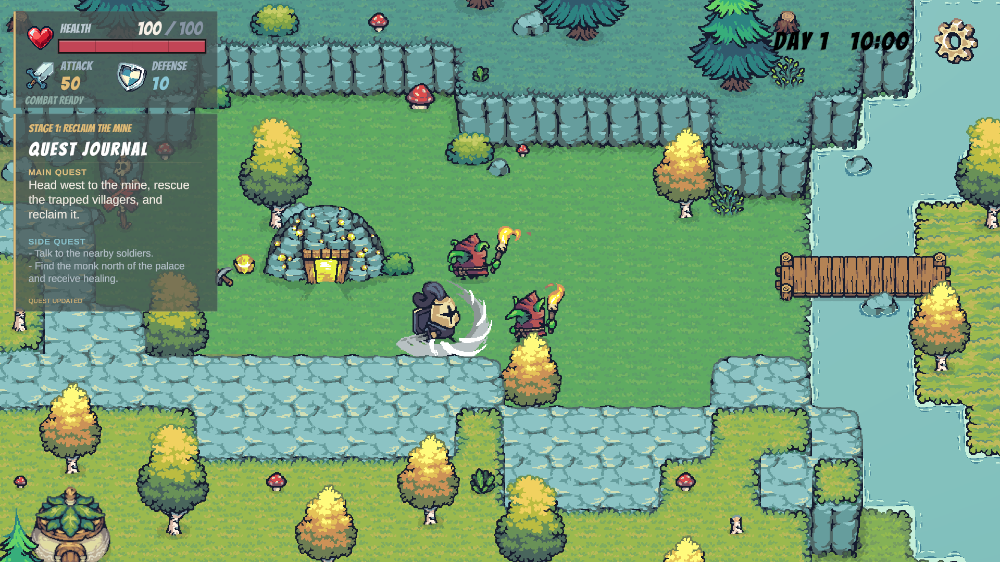 | 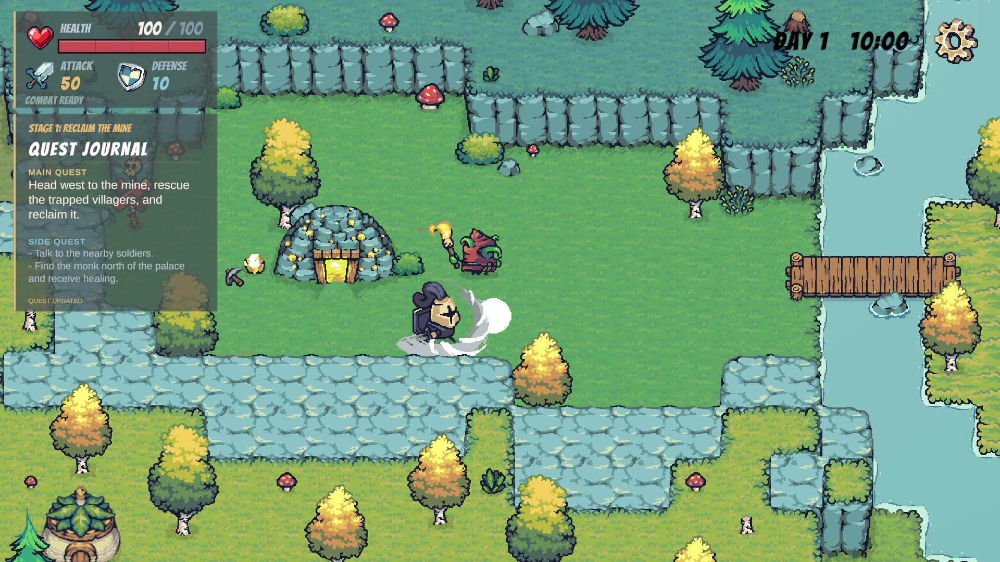 |

View the Troll and Shaman boss encounters

| Troll Boss | Goblin Shaman Boss |
| --- | --- |
| 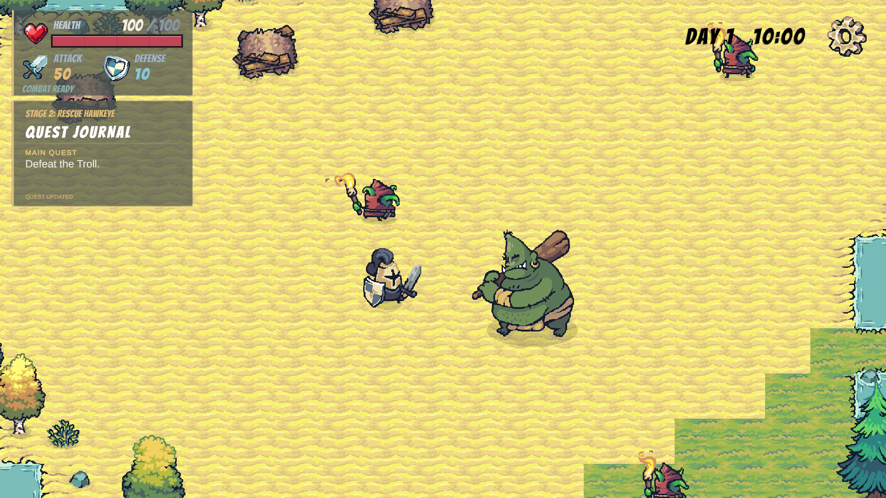 | 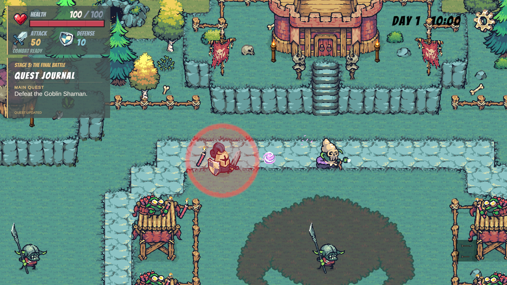 |

### Transformation, Disguise, and Archer Support

The knight can switch between human and Torch Goblin forms. While his identity remains concealed, the goblin form avoids normal enemy detection. Dealing damage reveals the disguise. Transformation is also restricted by combat state, encouraging players to choose when to use it.

As the story progresses, players can unlock support from their ally **Hawkeye**. Enter targeting mode, select an enemy, and call in a ranged attack. The ability includes a cooldown and on-screen feedback.

| Goblin Disguise | Hawkeye's Archer Support |
| --- | --- |
| 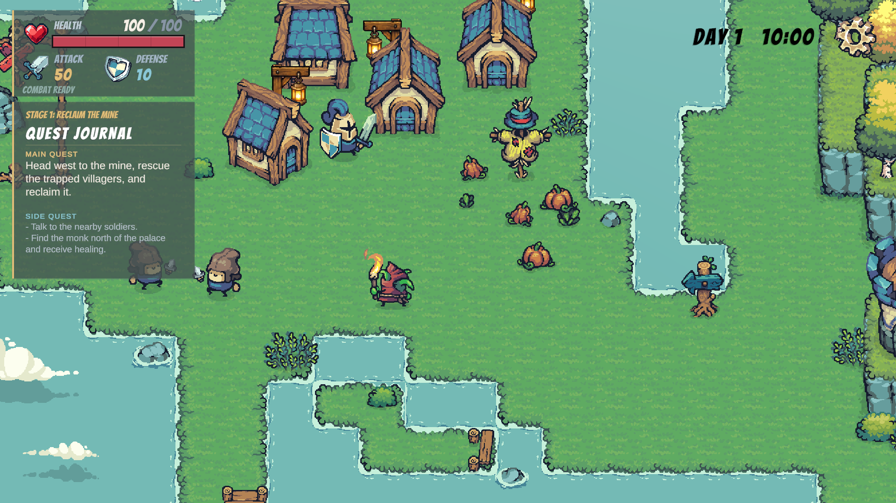 | 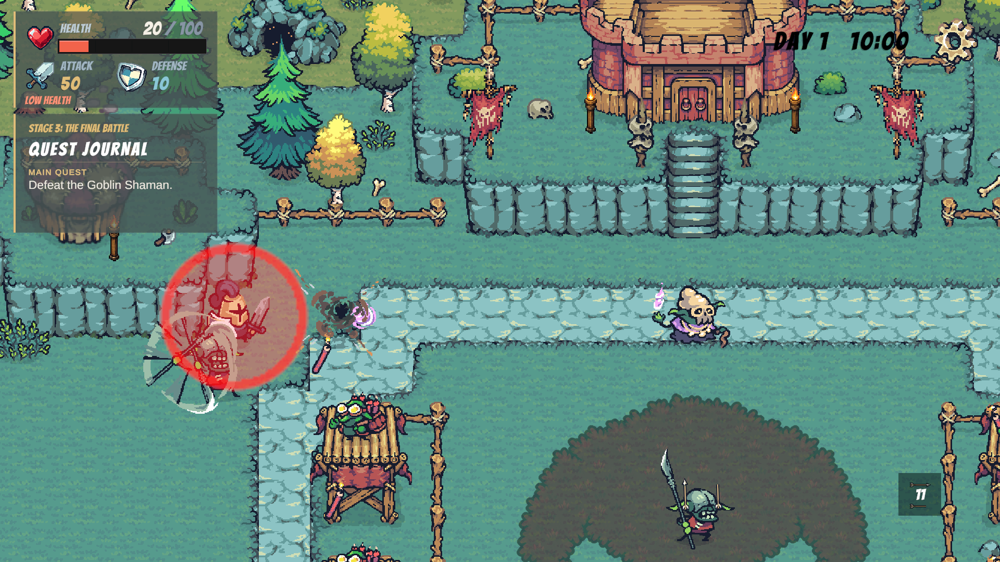 |

### Story, Dialogue, and Quest Progression

The adventure follows four main stages: **Awakening, Reclaim the Mine, Rescue Hawkeye, and The Final Battle**. NPC conversations, enemy objectives, and scripted sequences drive progression. The quest journal tracks main and side objectives, while new areas open as the story advances.

The game also integrates opening narration, camera sequences, saving and continuing, retries from the current story stage after death, and an epilogue after completing the main quest.

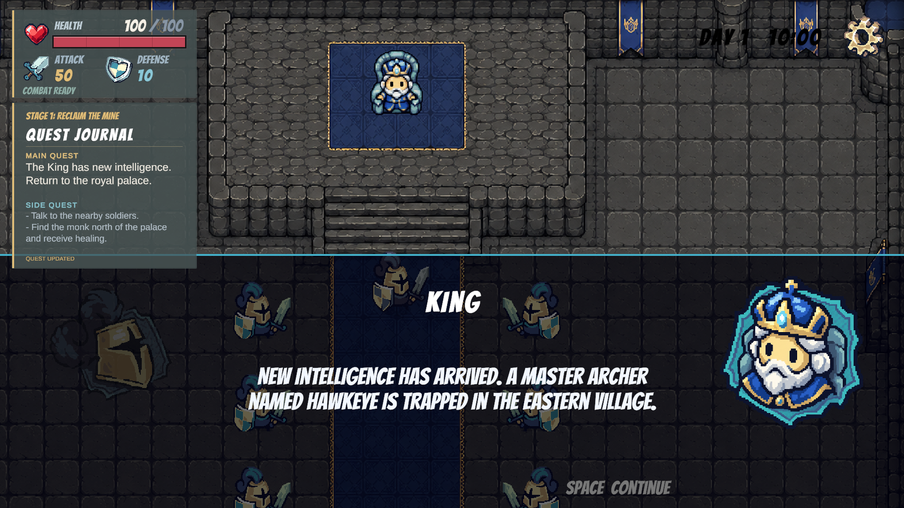

### Day and Night, Weather, and Rest

The world clock drives day/night changes and scene lighting. Late-night fatigue affects the knight's attributes, and players can return home to rest until morning. Rain, ground splashes, water, and puddle effects add atmosphere to exploration.

| Daytime Exploration | Midnight Fatigue and Rest |
| --- | --- |
| 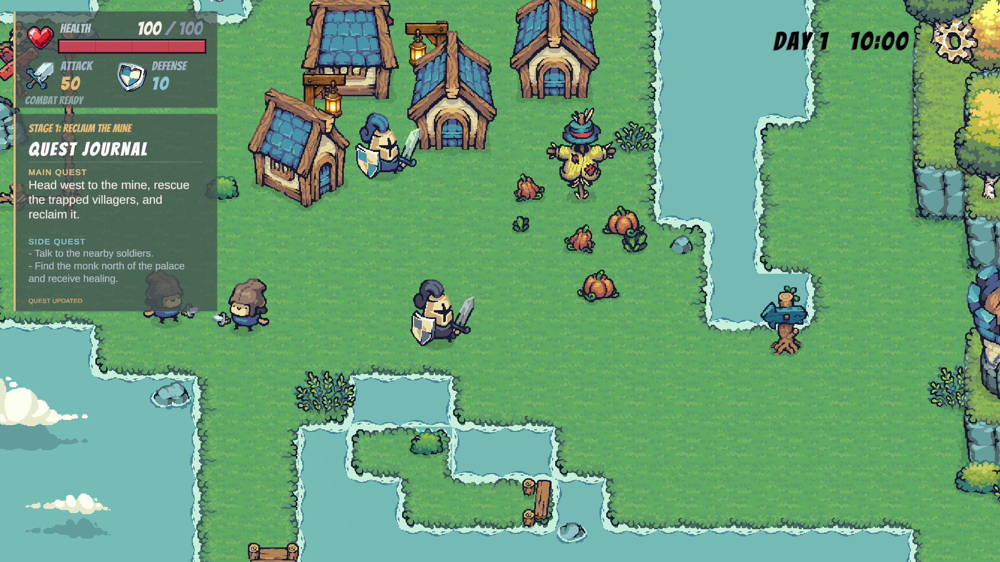 | 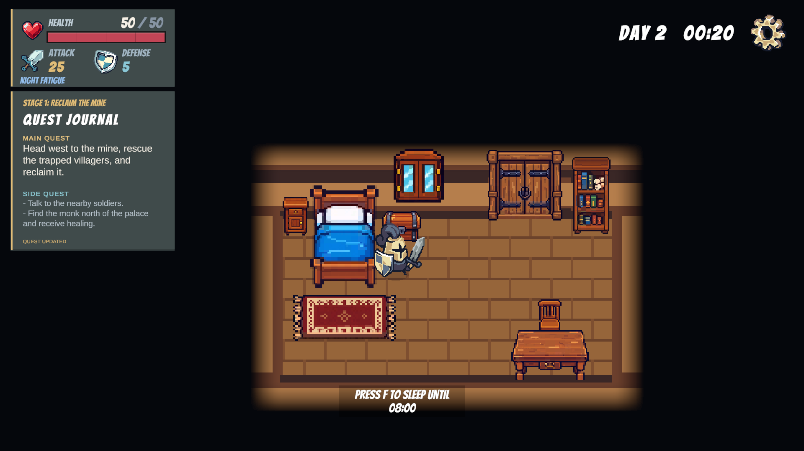 |

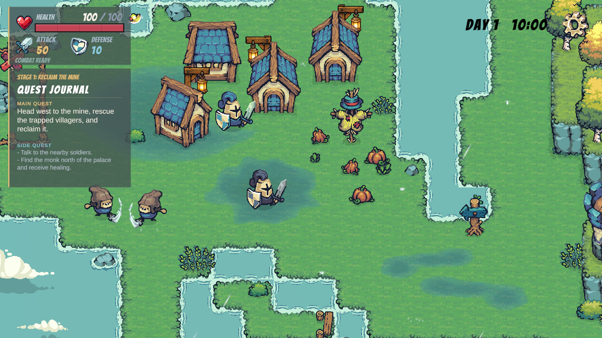

## Controls

| Input | Action |
| --- | --- |
| `W A S D` / Arrow keys | Move |
| Left mouse click | Normal attack |
| Hold left mouse button | Heavy attack |
| Hold right mouse button | Defend |
| `Q` | Switch between human and goblin forms, subject to combat restrictions |
| `E` | Talk to NPCs; follow the on-screen prompt |
| `F` | World interactions such as entering buildings, healing, and resting; follow the on-screen prompt |
| `Space` | Advance dialogue |
| `R`, then left-click a target | Use archer support after unlocking it through the story |
| `R` / `Esc` while targeting | Cancel archer support targeting |
| `Esc` | Pause / Resume |

## Art Assets and Acknowledgments

This project uses the **[Tiny Swords](https://pixelfrog-assets.itch.io/tiny-swords)** asset pack by **[Pixel Frog](https://pixelfrog-assets.itch.io/)**, including assets from the Free Pack, Enemy Pack, and related updates. Many thanks to the creator for the character sprites, animations, buildings, terrain, decorations, and UI assets.

Tiny Swords and other third-party assets remain the property of their respective creators and are not claimed as original artwork for this project. Their use and redistribution are subject to their applicable licenses. Please obtain assets from their official sources. This repository contains project documentation and game screenshots, without the original third-party asset files.

See [CREDITS.md](CREDITS.md) for further attribution details.

## Development Status and Future Releases

The game is still being refined. This repository currently provides an overview and gameplay screenshots. **It does not include the Unity project, executable builds, or a downloadable release.**

Further work will focus on gameplay refinement, combat balance, and presentation. A playable build is planned for GitHub Releases once these improvements and testing are complete.

All screenshots show the game in development. The final version may differ.
